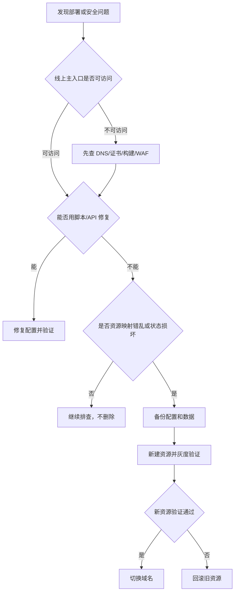
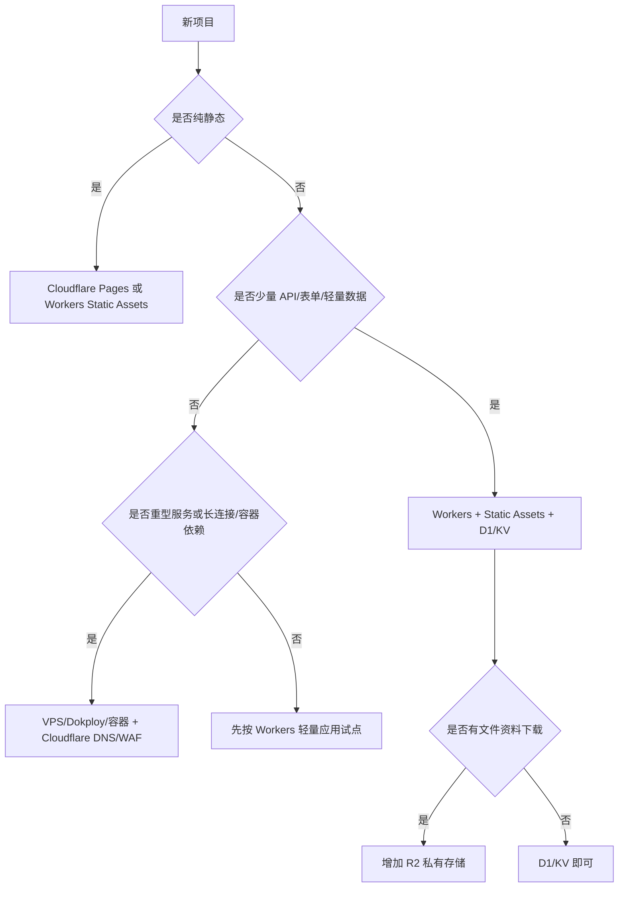
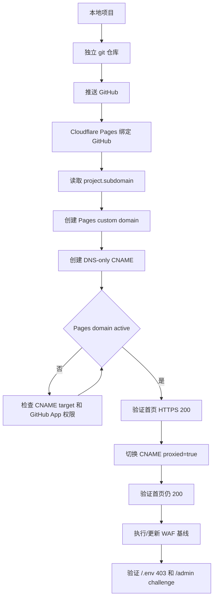
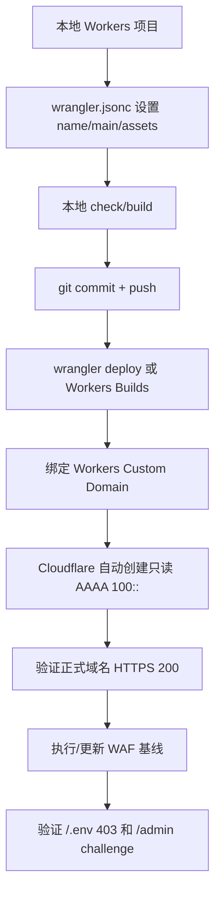
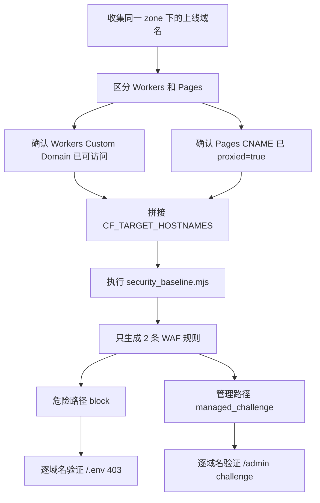
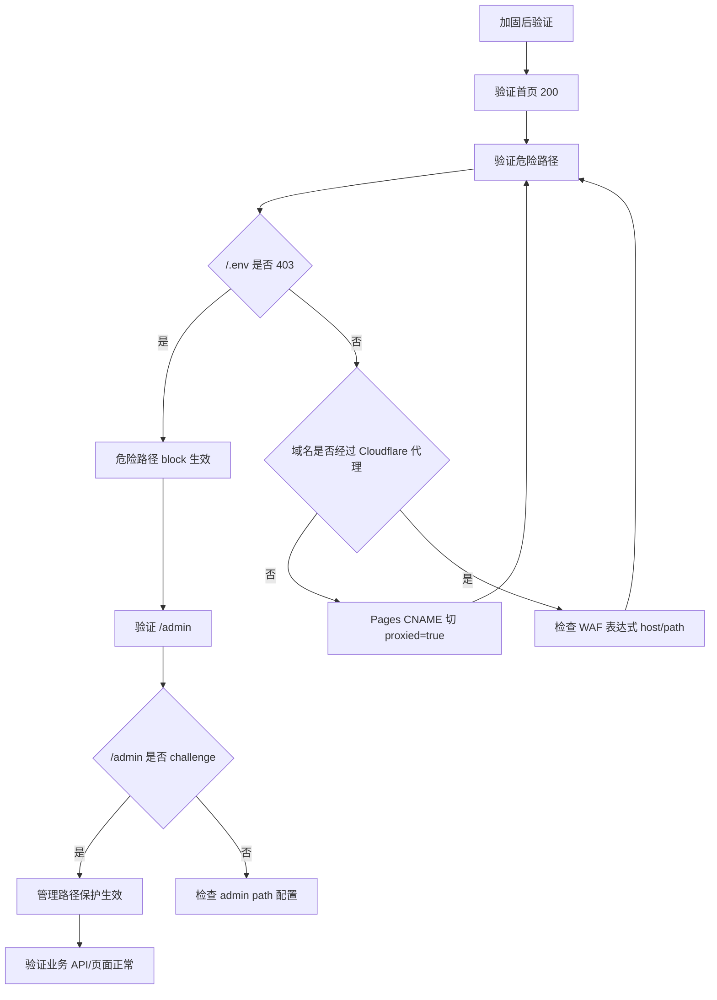
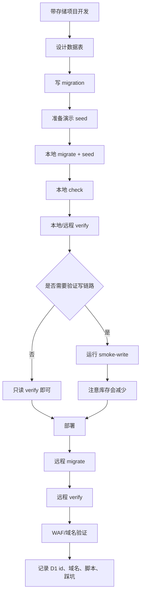
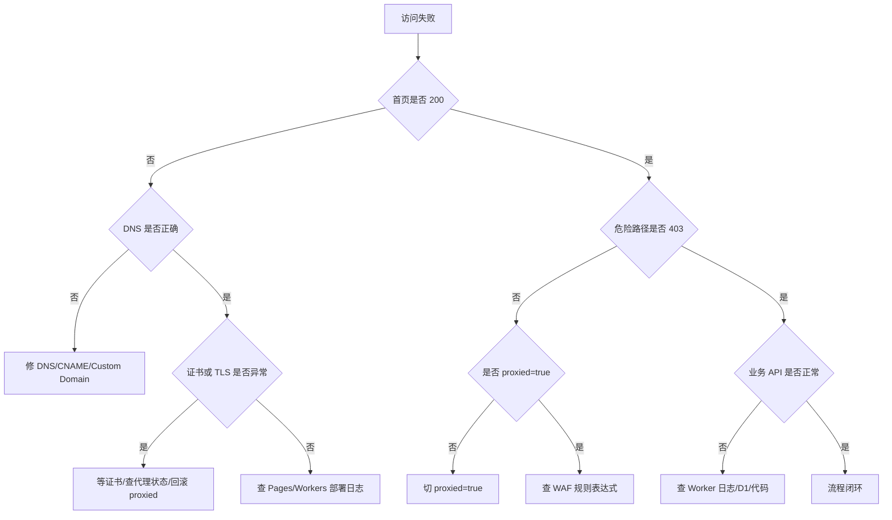
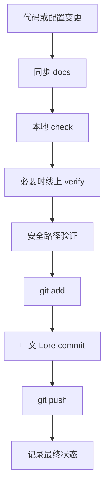

# Cloudflare 部署加固验证流程图

## 背景

这次从 GitHub、Cloudflare Pages、Workers、D1、DNS、WAF、安全脚本一路跑下来，真正有价值的不是某一条命令，而是完整流程：

```text
判断项目类型
-> 选择部署车道
-> 绑定域名
-> 验证 HTTPS
-> 配置 WAF
-> 验证危险路径
-> 验证业务接口
-> 记录踩坑
-> 提交推送
```

本文用流程图固化这套经验。后续新项目不要重新摸索，直接按图执行。

## 是否需要删除 Cloudflare 资源重建

结论：

```text
当前没有必要删除已托管内容再重新部署。
```

原因：

```text
1. ai.eforge.xyz、acctbox.eforge.xyz、tool.eforge.xyz、shop.eforge.xyz 都已 HTTP 200。
2. 四个域名已经合并到同一套 WAF 规则。
3. Workers 域名危险路径已返回 403。
4. Pages 域名切 proxied=true 后危险路径也返回 403。
5. 删除重建会引入新的 DNS、证书、Pages active、缓存、构建触发风险。
```

删除重建只适合以下情况：

```text
1. 项目名、仓库、Cloudflare project/service 对应关系完全错乱。
2. 误绑定到错误域名，且无法通过更新绑定修复。
3. 误泄露生产密钥，需要整体轮换并重建环境。
4. 资源状态损坏，Cloudflare API 和 Dashboard 都无法修复。
5. 明确做灾备演练，而且已经备份配置、DNS、D1、R2、Secrets。
```

流程图：



## 项目类型选择流程



当前实践映射：

| 项目 | 类型 | 车道 |
| --- | --- | --- |
| `ai.eforge.xyz` | Workers 静态/工具 | Workers Custom Domain |
| `acctbox.eforge.xyz` | Workers + Static Assets + D1 | 带存储轻量应用 |
| `tool.eforge.xyz` | Pages 静态工具 | Pages + CNAME |
| `shop.eforge.xyz` | Pages 落地页 | Pages + CNAME |

## Pages 标准流程



关键命令：

```bash
CF_AUTH_EMAIL="<email>" \
CF_GLOBAL_API_KEY="<global-api-key>" \
CF_CUSTOM_DOMAIN="tool.eforge.xyz" \
rtk node ../scripts/cloudflare/pages_github_domain_workflow.mjs
```

Pages active 后切橙云：

```bash
CF_AUTH_EMAIL="<email>" \
CF_GLOBAL_API_KEY="<global-api-key>" \
CF_CUSTOM_DOMAIN="tool.eforge.xyz" \
CF_DNS_PROXIED=true \
rtk node ../scripts/cloudflare/pages_github_domain_workflow.mjs
```

坑点：

```text
1. 初始验证阶段，DNS-only 更稳。
2. WAF 生效阶段，必须 proxied=true。
3. 不要猜 <project>.pages.dev，必须读取 project.subdomain。
```

## Workers 标准流程



关键命令：

```bash
CF_AUTH_EMAIL="<email>" \
CF_GLOBAL_API_KEY="<global-api-key>" \
CF_WORKER_SERVICE="acctbox" \
CF_CUSTOM_DOMAIN="acctbox.eforge.xyz" \
rtk node scripts/cloudflare/workers_custom_domain_bind.mjs
```

坑点：

```text
1. Workers Custom Domain 不是 Pages CNAME。
2. 不要手动改 Cloudflare 创建的 AAAA 100:: read_only 记录。
3. Workers Custom Domain 默认走 Cloudflare 代理层，WAF 可直接生效。
```

## WAF 合并规则流程

这是本次最重要的最佳实践之一。

不要为每个域名单独创建规则。免费层 WAF Custom Rules 数量有限，同一个 zone 下的多个域名应该合并到一套规则。



当前统一命令：

```bash
CF_TARGET_HOSTNAMES="acctbox.eforge.xyz,ai.eforge.xyz,tool.eforge.xyz,shop.eforge.xyz" \
CF_SECURITY_SCENARIO="app" \
CF_ENABLE_ZONE_SETTINGS=false \
CF_APPLY=true \
rtk node scripts/cloudflare/security_baseline.mjs
```

当前结果：

```text
规则集：f11832fb70494c2bbe5f6e566264fa70
规则数量：2
覆盖域名：acctbox、ai、tool、shop
```

## 安全验证流程



当前标准验证命令：

```bash
rtk curl -sS -I https://acctbox.eforge.xyz/
rtk curl -sS -I https://acctbox.eforge.xyz/.env
rtk curl -sS -I https://acctbox.eforge.xyz/admin

rtk curl -sS -I https://ai.eforge.xyz/
rtk curl -sS -I https://ai.eforge.xyz/.env
rtk curl -sS -I https://ai.eforge.xyz/admin

rtk curl -sS -I https://tool.eforge.xyz/
rtk curl -sS -I https://tool.eforge.xyz/.env
rtk curl -sS -I https://tool.eforge.xyz/admin

rtk curl -sS -I https://shop.eforge.xyz/
rtk curl -sS -I https://shop.eforge.xyz/.env
rtk curl -sS -I https://shop.eforge.xyz/admin
```

## 带存储项目流程

`acctbox` 这类带 D1 的项目，流程不能只看页面。



标准：

```text
1. migration 进 Git。
2. seed 只能是演示数据。
3. verify 必须只读。
4. smoke-write 会改变数据，不能当日常巡检。
5. 真实业务必须补 backup/export。
```

## 故障分流流程



## 每次变更闭环



硬规则：

```text
1. 每次代码变更必须提交。
2. 脚本变量变更必须同步脚本头部注释和 docs/025。
3. Cloudflare 配置变更必须记录实际验证结果。
4. 发现坑必须写背景、原因、排查过程、解决方案、建议。
```

## 当前结论

```text
不删除现有 Cloudflare 托管内容。
保留现有成功资源。
用脚本做幂等修复、加固和验证。
把从零部署流程、现有项目加固流程、删除重建决策流程全部固化到文档。
```
