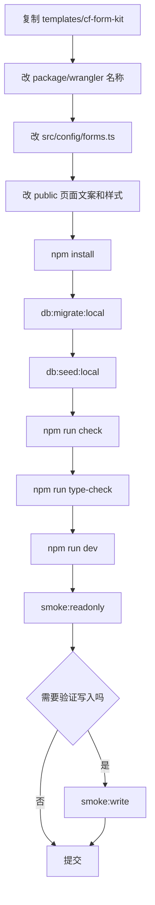

# CF Form Kit 微型框架落地方案

## 背景

后续会有大量类似项目：

```text
填表
信息收集
邀请申请
资料领取
落地页转化
轻量交互
```

如果每次都从零写 Worker、D1、校验、部署脚本、安全头、WAF 验证，会重复踩坑。

因此本次新增一个可复制模板：

```text
templates/cf-form-kit
```

目标不是做大平台，而是做“小而美”的微型框架：

```text
后续新项目主要改业务配置。
底层部署、安全、D1、验证、脚本复用。
```

## 技术结论

采用：

```text
Cloudflare Workers + Static Assets
D1
Hono
Zod + @hono/zod-validator
Drizzle ORM schema
Wrangler migrations
Turnstile 可选
D1 限流
Idempotency-Key
ADMIN_TOKEN
```

不采用：

```text
Next.js
复杂后台框架
自研 ORM
自研迁移系统
复杂多租户平台
```

原因：

```text
1. 这类项目多数低流量、低复杂度。
2. Cloudflare Workers + D1 的部署闭环已经跑通。
3. Hono 足够轻，适合 Workers。
4. Zod 解决表单输入边界。
5. Drizzle 先作为 schema 和类型基础，不强行复杂化查询。
6. Wrangler migrations 仍然是 D1 迁移主线。
```

## 模板结构

```text
templates/cf-form-kit/
  package.json
  wrangler.jsonc
  tsconfig.json
  seed.sql
  migrations/
    0001_init.sql
  public/
    index.html
    app.js
    styles.css
    _headers
  src/
    index.ts
    bindings.ts
    config/
      forms.ts
    db/
      client.ts
      schema.ts
    lib/
      http.ts
      idempotency.ts
      rate-limit.ts
      security.ts
    routes/
      admin.ts
      forms.ts
      health.ts
  scripts/
    check.mjs
    deploy-full.mjs
    smoke-readonly.mjs
    smoke-write.mjs
```

## 后续只改哪里

优先只改：

```text
src/config/forms.ts
public/index.html
public/styles.css
wrangler.jsonc 的 name/database_name/vars
```

一般不改：

```text
src/lib/*
scripts/*
migrations/0001_init.sql
```

如果业务需要新增表，再新增 migration，不直接改旧 migration。

## 内置能力

### 1. 表单配置

入口：

```text
src/config/forms.ts
```

支持：

```text
text
email
textarea
select
required
maxLength
options
```

### 2. API

```text
GET  /api/health
GET  /api/forms/:slug
POST /api/forms/:slug/submissions
GET  /api/admin/submissions
```

### 3. D1 表

```text
forms
submissions
request_logs
idempotency_keys
admin_audit_logs
```

### 4. 安全

```text
Zod 入参校验
业务字段白名单校验
Turnstile 可选
D1 请求日志限流
Idempotency-Key 防重复提交
ADMIN_TOKEN 管理接口
_headers 安全响应头
WAF 基线脚本复用
```

## 开发流程图



## 部署流程图

```mermaid
flowchart TD
  A[本地验证通过] --> B[git commit + push]
  B --> C[创建或复用 D1]
  C --> D[写入 database_id]
  D --> E[远程 migration]
  E --> F[可选 seed]
  F --> G[wrangler deploy]
  G --> H[绑定 Workers Custom Domain]
  H --> I[smoke:readonly]
  I --> J[security_baseline 合并 WAF]
  J --> K[首页 200]
  K --> L[/.env 403]
  L --> M[/admin challenge]
  M --> N[docs 记录]
```

## 和 AcctBox 的关系

`acctbox` 是具体业务试点：

```text
发卡
库存
订单
卡密
```

`cf-form-kit` 是通用微型模板：

```text
表单
信息收集
轻交互
线索收集
```

二者复用同一套部署和安全经验，但业务模型不同。

## 为什么不直接重构 AcctBox

暂不重构。

原因：

```text
1. AcctBox 已经跑通完整 D1 发卡链路。
2. 发卡业务比普通表单更强调库存一致性。
3. 为了套框架重构已跑通代码，风险大于收益。
4. 新模板先服务后续同类表单项目。
```

后续如果 AcctBox API 继续增加，再考虑把 Hono/Zod/Drizzle 分阶段引入。

## 标准命令

```bash
rtk npm install
rtk npm run db:migrate:local
rtk npm run db:seed:local
rtk npm run check
rtk npm run type-check
rtk npm run dev
rtk npm run smoke:readonly
```

写入验证：

```bash
rtk npm run smoke:write
```

部署：

```bash
CLOUDFLARE_API_TOKEN="<token>" \
FORMKIT_SEED_REMOTE=false \
BASE_URL="https://<your-domain>" \
rtk npm run deploy:full
```

## 依赖版本依据

2026-05-25 已用 npm 查询：

```text
hono: 4.12.22
@hono/zod-validator: 0.8.0
zod: 4.4.3
drizzle-orm: 0.45.2
wrangler: 4.94.0
typescript: 6.0.3
@cloudflare/workers-types: 4.20260524.1
```

说明：

```text
模板默认不安装 drizzle-kit。
当前 migration 主线是 Wrangler D1 migrations。
Drizzle ORM 保留为 schema 和类型基础。
当表超过 5 张、迁移生成需求明确后，再单独引入 drizzle-kit。
```

## 官方资料依据

```text
Hono Cloudflare Workers:
https://hono.dev/docs/getting-started/cloudflare-workers

Hono validation:
https://hono.dev/docs/guides/validation

Drizzle Cloudflare D1:
https://orm.drizzle.team/docs/connect-cloudflare-d1

Cloudflare D1 migrations:
https://developers.cloudflare.com/d1/reference/migrations/
```

## 下一步建议

短期：

```text
1. 用模板创建一个真实小表单项目试点。
2. 跑通本地 migration、seed、readonly smoke、write smoke。
3. 绑定一个测试域名并合并进 WAF。
```

中期：

```text
1. 抽一个 create 脚本，自动替换项目名、数据库名、域名。
2. 增加 R2 私有下载模板。
3. 增加只读管理页。
```

仍然不要做：

```text
复杂后台平台
多租户系统
自研框架
复杂权限中心
```

## 本次验证记录

日期：

```text
2026-05-25
```

验证命令：

```bash
rtk npm install
rtk npm run check
rtk npm run type-check
rtk npm audit
rtk npm run db:migrate:local
rtk npm run db:seed:local
rtk npm run dev
rtk npm run smoke:readonly
rtk npm run smoke:write
```

结果：

```text
check：通过
type-check：通过
npm audit：0 vulnerabilities
db:migrate:local：0001_init.sql 成功执行
db:seed:local：seed.sql 成功执行
GET /api/health：ok=true，storage=d1，forms=["lead"]
smoke:readonly：通过
smoke:write：通过，成功写入一条 submission
```

踩坑：

```text
wrangler.jsonc 的 compatibility_date 不能写未来日期。
最初使用 2026-05-25 时，Wrangler 4.94.0 报 unsupported。
已改为 2026-05-24，并在 README 中记录。
```

依赖调整：

```text
最初把 drizzle-kit 放入默认 devDependencies，npm audit 报 4 个中危，来源是开发链路的 esbuild。
由于当前模板迁移主线是 Wrangler D1 migrations，默认不需要 drizzle-kit。
移除 drizzle-kit 后完整 npm audit 为 0 vulnerabilities。
```
