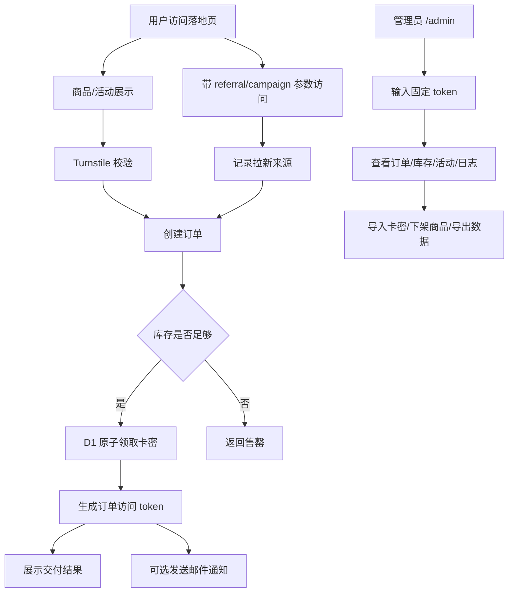
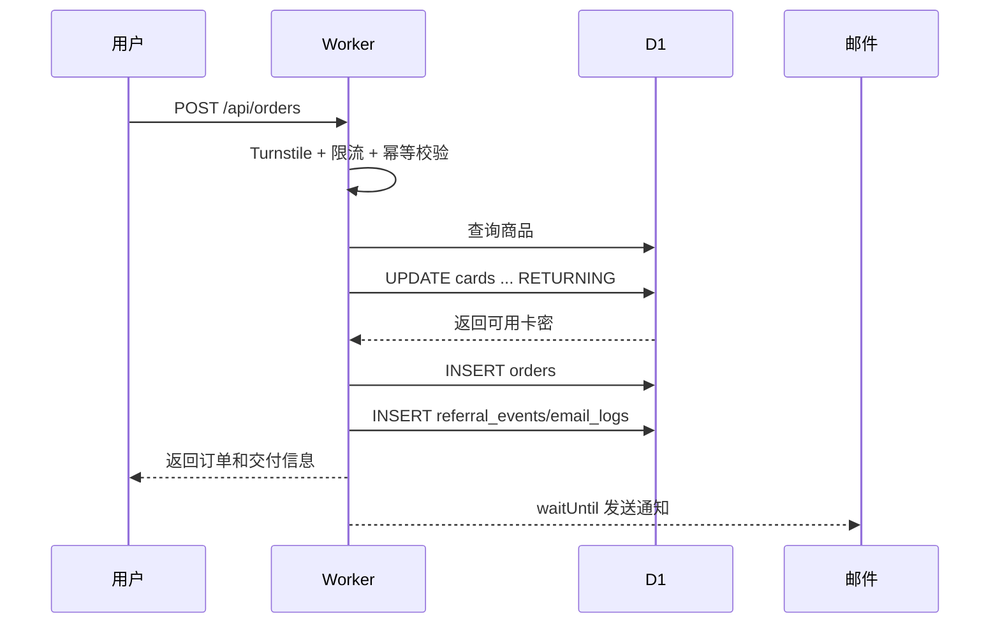
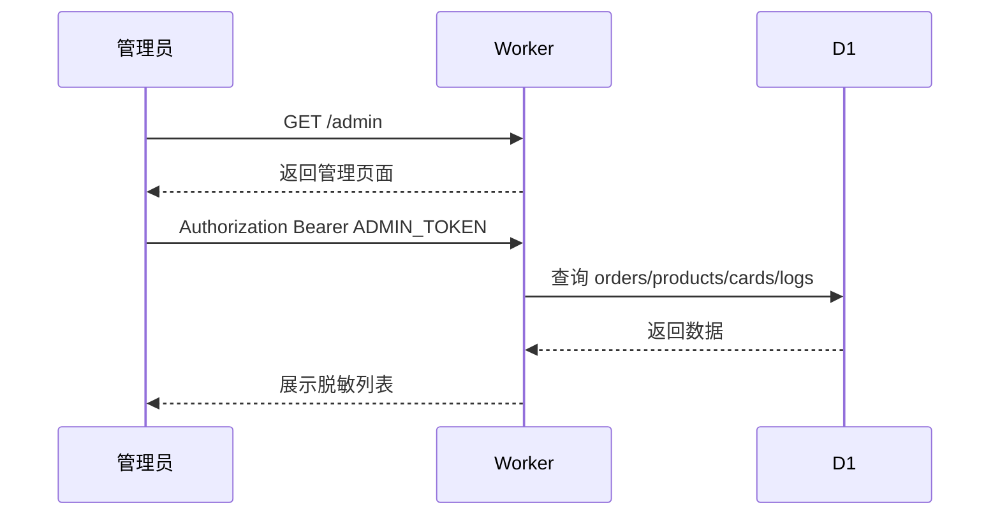

# AcctBox 发卡营销管理全流程方案

## 背景

`acctbox` 当前已经跑通：

```text
Cloudflare Workers + Static Assets
D1
商品列表
卡密库存
订单创建
卡密发放
自定义域名
WAF 基础防护
verify / smoke
```

现在要进一步判断：发卡业务是否能在 Cloudflare 免费/低成本生态里，轻量补上营销、管理端、通知和运维闭环。

结论：

```text
可以，但必须克制。
Cloudflare 适合做轻量发卡、低流量订单、基础营销、简单管理端。
不适合直接做复杂 CRM、完整会员系统、重型营销自动化、复杂财务对账和大型客服后台。
```

## 总体架构



## 业务模块

### 1. 商品和库存

当前已有：

```text
products
cards
orders
```

建议补充：

```text
products:
  sort_order
  cover_url
  tags
  sales_copy

cards:
  batch_id
  disabled_reason
  delivery_secret 加密或至少只在必要接口返回

orders:
  order_token
  referral_code
  campaign_code
  buyer_email
  delivered_at
```

核心原则：

```text
库存扣减必须继续使用 D1 原子更新。
不要用 KV 做发卡主库。
不要把真实卡密放 seed.sql。
```

### 2. 轻量营销

只做四个低成本功能：

```text
1. 活动链接 campaign。
2. 邀请/裂变 referral。
3. 优惠码 coupon。
4. 轻量促活 email/reminder。
```

不做：

```text
复杂积分系统
多级分销
会员等级
自动化营销编排
复杂风控模型
```

推荐表：

```sql
campaigns(
  code,
  name,
  active,
  starts_at,
  ends_at,
  metadata_json
)

referral_codes(
  code,
  owner_contact,
  reward_type,
  reward_value,
  active,
  created_at
)

referral_events(
  id,
  referral_code,
  order_id,
  buyer_contact,
  status,
  created_at
)

coupons(
  code,
  discount_type,
  discount_value,
  max_uses,
  used_count,
  active,
  expires_at
)
```

### 3. 管理端

入口：

```text
https://acctbox.eforge.xyz/admin
```

鉴权：

```text
固定 ADMIN_TOKEN
通过 wrangler secret 保存
前端输入 token，之后放 sessionStorage
API 使用 Authorization: Bearer <token>
```

为什么这样设计：

```text
1. 个人项目低流量，固定 token 足够作为第一版。
2. 比登录系统轻很多。
3. 比把管理 API 裸露在公网安全很多。
4. 后续可以平滑升级 Cloudflare Access。
```

管理端最小功能：

```text
1. 看订单列表。
2. 看订单详情。
3. 看库存数量。
4. 看卡密批次。
5. 导入卡密。
6. 禁用卡密。
7. 下架商品。
8. 导出 CSV。
9. 看 request_logs。
10. 看 admin_audit_logs。
```

管理端不要第一版就做：

```text
复杂角色权限
多管理员团队
图表大屏
在线客服
复杂筛选器
复杂退款流程
```

### 4. 邮件通知

邮件不是第一优先级。发卡最核心的是：

```text
网页上能完成交付。
订单 token 能再次查看。
管理员能查订单。
```

邮件作为增强：

```text
1. 给买家发送订单摘要和查看链接。
2. 给管理员发送新订单通知。
3. 给邀请人发送裂变成功通知。
```

默认推荐：

```text
Cloudflare Email Service / Workers Email Sending
```

原因：

```text
1. 官方已经支持 Workers 通过 binding 发送邮件。
2. 和 Cloudflare Workers/DNS 生态一致。
3. 适合低频系统通知。
```

备选推荐：

```text
Resend
```

原因：

```text
1. Resend 有官方 Cloudflare Workers 文档。
2. API 简单。
3. 域名验证后可以从自有域名发信。
```

不推荐 SendGrid 作为默认免费路线：

```text
SendGrid 当前官方定价页显示 Free Trial 是 60 天试用，不适合作为长期免费默认方案。
```

邮件实现原则：

```text
1. 邮件发送失败不能影响发卡成功。
2. 使用 ctx.waitUntil 异步发送。
3. email_logs 记录 pending/sent/failed。
4. 邮件里不要直接放完整卡密，放订单查看链接。
5. 查看链接使用 order_token，过期或可手动失效。
```

推荐表：

```sql
email_logs(
  id,
  order_id,
  to_email,
  template,
  status,
  provider,
  error_message,
  created_at,
  sent_at
)
```

## 安全方案

### 用户侧

必须：

```text
1. WAF 阻断危险路径。
2. POST /api/orders 接 Turnstile。
3. IP + 联系方式 + 商品维度限流。
4. idempotency_key 防重复提交。
5. 订单 token 随机且不可枚举。
6. 卡密只在订单结果页和订单 token 详情页展示。
```

### 管理侧

必须：

```text
1. /admin 被 WAF Managed Challenge 保护。
2. /api/admin/* 必须 ADMIN_TOKEN。
3. 管理操作写 admin_audit_logs。
4. 管理列表默认隐藏完整 delivery_secret。
5. 导出 CSV 需要再次确认。
```

升级选项：

```text
Cloudflare Access 保护 /admin/*
```

但第一版不强制，因为会增加账号和配置复杂度。

## 数据流

### 下单发卡



### 管理查看



## 和 CF Form Kit 底座的关系

`templates/cf-form-kit` 已经提供：

```text
Hono 路由
Zod 校验
D1 migrations
Drizzle schema
request_logs
idempotency_keys
admin_audit_logs
ADMIN_TOKEN
Turnstile 入口
只读 smoke / 写入 smoke
```

发卡业务需要在这个底座上新增：

```text
products
cards
orders
campaigns
referral_codes
referral_events
coupons
email_logs
```

这说明底座方向是正确的，但发卡不是普通表单，需要单独的业务模块。

## Cloudflare 是否仍是最优解

### 开发

优点：

```text
1. Workers + D1 + Static Assets 一体部署。
2. Hono/Zod/Drizzle 能形成轻量工程化。
3. 不需要维护服务器。
4. 脚本和文档已经沉淀。
```

缺点：

```text
1. 本地 D1 和远程 D1 仍需认真管理。
2. 不适合复杂后台和重型任务。
3. Email、支付、文件下载都需要谨慎拆边界。
```

结论：

```text
低流量发卡项目，Cloudflare 仍是当前最优默认方案。
```

### 部署

优点：

```text
GitHub
Wrangler
Workers Custom Domain
WAF
HTTPS
全部已经跑通。
```

结论：

```text
Cloudflare 最适合做这类小应用的上线底座。
```

### 运维

优点：

```text
无需服务器补丁。
无需 Nginx。
无需自签证书。
WAF/DNS/HTTPS 集中处理。
```

风险：

```text
1. D1 备份需要补脚本。
2. 邮件失败需要日志。
3. 管理 token 泄露需要轮换。
4. Cloudflare 免费额度需要监控。
```

结论：

```text
个人开发者低成本运维，Cloudflare 明显优于 VPS 自建。
```

### 成本

当前最小成本：

```text
Workers Free
D1 Free
Email Routing/Email Service 视当前账号能力
WAF Free
DNS Free
GitHub Free
```

需要付费或外部服务时：

```text
邮件量变大：Resend 或 Cloudflare Email Service 付费能力
文件资料变多：R2
业务变重：VPS/Dokploy 或 Supabase/Postgres
```

## 分阶段路线

### 第 1 阶段：轻量发卡闭环

```text
1. ADMIN_TOKEN 管理端。
2. 订单列表和库存列表。
3. 卡密导入。
4. 订单 token 查看。
5. Turnstile。
6. 限流。
7. 只读 smoke。
```

### 第 2 阶段：轻营销

```text
1. campaign 链接。
2. referral_code。
3. coupon。
4. referral_events。
5. 管理端查看拉新来源。
```

### 第 3 阶段：通知

```text
1. email_logs。
2. Cloudflare Email Service 或 Resend。
3. 买家订单摘要邮件。
4. 管理员新订单通知。
```

### 第 4 阶段：资料交付

```text
1. R2 私有 bucket。
2. 订单 token 鉴权下载。
3. 下载次数限制。
4. 下载日志。
```

## 不要做的事

```text
1. 不要第一版做复杂会员系统。
2. 不要做多级分销。
3. 不要做大后台。
4. 不要把邮件作为发卡成功的唯一交付方式。
5. 不要把真实卡密放 Git。
6. 不要把 KV 当订单/库存主库。
7. 不要为了营销功能破坏发卡原子性。
```

## 官方资料

```text
Cloudflare Workers Email Sending:
https://developers.cloudflare.com/email-routing/email-workers/send-email-workers/

Cloudflare Email Service:
https://developers.cloudflare.com/email-service/

Resend Cloudflare Workers:
https://resend.com/docs/send-with-cloudflare-workers

SendGrid Pricing:
https://sendgrid.com/en-us/pricing
```

## 最终建议

```text
AcctBox 继续走 Cloudflare Workers + D1。
管理端用 /admin + ADMIN_TOKEN 起步。
营销只做 campaign/referral/coupon 三件小事。
邮件先作为增强通知，不作为核心交付。
底座复用 CF Form Kit 的 Hono/Zod/D1/限流/幂等/管理 token 思路。
等真实订单和维护压力出现，再决定是否引入 R2、Cloudflare Access、Resend 或 VPS。
```
