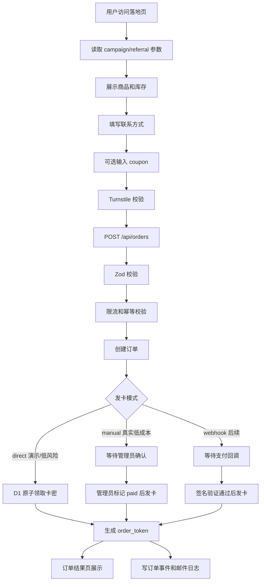

# AcctBox 发卡项目 V2 开发蓝图

> ⚠️ D1 已取消，项目已完全迁移到 Turso/libsql

## 结论

`acctbox` 后续应该作为 `CF Form Kit` 微型底座的第一个业务验证项目，但不能机械复制普通表单模板。

原因：

```text
普通表单重在收集。
发卡项目重在库存一致性、订单可追溯、卡密交付安全和管理端可维护。
```

最优路线：

```text
Cloudflare Workers + Static Assets
~~D1~~（已取消） 作为订单、库存、营销和日志主库
Hono 管路由
Zod 管输入边界
Drizzle ORM 管 schema 和常规查询
Wrangler migrations 管 ~~D1~~（已取消） 迁移
~~D1~~（已取消） prepare().bind() 管必要 raw SQL
ADMIN_TOKEN 管轻量管理端
Turnstile + 限流 + 幂等 管低成本安全
```

暂不做：

```text
复杂会员系统
多级分销
重型 CRM
完整在线客服
复杂支付网关聚合
大后台权限系统
```

## 当前状态

当前 `acctbox` 已经跑通：

```text
Workers + Static Assets
~~D1~~（已取消）
products/cards/orders
商品列表
库存展示
POST /api/orders 直接发卡
UPDATE cards ... RETURNING 原子领取库存
acctbox.eforge.xyz 自定义域名
Cloudflare WAF 基线
部署、域名、smoke 脚本
```

当前不足：

```text
1. 还是单文件 JavaScript Worker，后续扩展会越来越难。
2. 没有 Zod 入参校验。
3. 没有 Hono 路由分层。
4. 没有 ADMIN_TOKEN 管理接口。
5. 没有订单 token，用户无法安全二次查看交付结果。
6. 管理端没有权限边界。
7. 营销字段、优惠码、邀请来源还没有落库。
8. 邮件和通知没有日志闭环。
9. D1 备份、导出、导入还没有标准化。
```

因此 V2 的第一目标不是做大功能，而是把发卡主链路整理成可长期复用的小型业务底座。

## 业务边界

### V2 必须覆盖

```text
1. 商品展示。
2. 库存展示。
3. 创建订单。
4. 原子发卡。
5. 订单 token 查看交付结果。
6. 管理端查看订单。
7. 管理端导入卡密。
8. 管理端查看库存。
9. 活动 campaign 来源记录。
10. 邀请 referral 来源记录。
11. 优惠码 coupon 抵扣。
12. request_logs / admin_audit_logs。
13. smoke:readonly / smoke:write。
14. deploy:full。
```

### V2 可以预留但不强做

```text
1. 邮件通知。
2. R2 私有资料下载。
3. Cloudflare Access 保护后台。
4. 支付 webhook。
5. CSV 导出。
```

### V2 不做

```text
1. 多管理员角色。
2. 多级分销。
3. 积分商城。
4. 自动化营销编排。
5. 复杂财务对账。
6. 复杂退款工单。
```

## 总流程



## 发卡模式

### direct

用途：

```text
演示
低价值资料
内部测试
smoke:write
```

行为：

```text
POST /api/orders 后立即扣库存并返回交付信息。
```

限制：

```text
不适合作为真实付费商品默认模式。
```

### manual

用途：

```text
个人开发者真实售卖的第一版默认模式。
```

行为：

```text
1. 用户提交订单。
2. 页面展示联系/支付说明或跳转购买链接。
3. 管理员在 /admin 查看订单。
4. 管理员确认付款后点击发卡。
5. 系统原子扣库存并生成 order_token。
```

优点：

```text
不用一开始接复杂支付。
不会出现未付款自动发卡。
适合低流量、人工可控的项目。
```

### webhook

用途：

```text
后续接 Stripe、Paddle、Creem、支付宝/微信第三方支付等。
```

行为：

```text
支付平台回调 -> 验签 -> 标记 paid -> 原子发卡。
```

V2 只预留字段，不优先实现。

## 页面规划

### 首页 `/`

目标：

```text
快速展示商品、价格、库存和购买入口。
```

主要字段：

| 字段 | 来源 | 说明 |
| --- | --- | --- |
| 商品标题 | products.title | 用户第一眼看到的商品名 |
| 商品说明 | products.description | 简短说明，不做长营销页 |
| 售价 | products.price_cents + currency | 使用前端格式化 |
| 库存 | cards 可用数量 | 只展示数量，不展示卡密 |
| 标签 | products.tags_json | 如 Netflix、ChatGPT、资料包 |
| 购买按钮 | 前端 | 有库存才可点击 |

### 下单区域 `/`

主要字段：

| 字段 | 必填 | 说明 |
| --- | --- | --- |
| productId | 是 | 选择商品 |
| buyerContact | 是 | Telegram、邮箱或其他联系方式 |
| buyerEmail | 否 | 用于邮件通知 |
| couponCode | 否 | 优惠码 |
| referralCode | 否 | 邀请码，可从 URL 带入 |
| campaignCode | 否 | 活动码，可从 URL 带入 |
| turnstileToken | 生产必填 | 防止脚本刷单 |

### 订单结果页 `/order`

目标：

```text
订单创建后展示订单状态和查看链接。
```

主要字段：

| 字段 | 说明 |
| --- | --- |
| orderNo | 给用户看的短订单号 |
| status | pending / paid / issued / canceled / failed |
| productTitle | 商品标题 |
| amount | 应付金额 |
| delivery | 已发卡时展示，未发卡时隐藏 |
| orderToken | 只在创建成功时返回一次 |
| lookupUrl | 用户二次查看订单的安全链接 |

### 订单查询页 `/lookup`

主要字段：

| 字段 | 说明 |
| --- | --- |
| orderToken | 用户输入或 URL 携带 |
| orderStatus | 当前订单状态 |
| deliverySecret | 仅 token 正确且订单已发卡时展示 |
| deliveryNote | 交付说明 |

### 管理端 `/admin`

鉴权：

```text
前端输入 ADMIN_TOKEN。
Token 存 sessionStorage。
API 使用 Authorization: Bearer <token>。
生产环境同时用 WAF 对 /admin 做 Managed Challenge。
```

页面模块：

| 模块 | V2 状态 | 说明 |
| --- | --- | --- |
| 登录 | 必须 | 固定 token |
| 概览 | 必须 | 订单数、库存数、今日发卡 |
| 订单列表 | 必须 | 默认脱敏展示 |
| 订单详情 | 必须 | 管理员可查看完整交付信息 |
| 确认发卡 | manual 模式必须 | 管理员确认付款后发卡 |
| 商品管理 | 必须 | 上架、下架、排序 |
| 卡密导入 | 必须 | textarea/CSV 粘贴导入 |
| 库存批次 | 建议 | 追踪卡密来源 |
| 优惠码 | 建议 | 创建、停用、使用次数 |
| 活动/邀请 | 建议 | 查看来源效果 |
| 日志 | 必须 | request_logs/admin_audit_logs |

## 数据模型

### products

```sql
products(
  id TEXT PRIMARY KEY,
  slug TEXT UNIQUE NOT NULL,
  title TEXT NOT NULL,
  description TEXT NOT NULL DEFAULT '',
  sales_copy TEXT NOT NULL DEFAULT '',
  cover_url TEXT NOT NULL DEFAULT '',
  tags_json TEXT NOT NULL DEFAULT '[]',
  price_cents INTEGER NOT NULL DEFAULT 0,
  currency TEXT NOT NULL DEFAULT 'CNY',
  fulfillment_mode TEXT NOT NULL DEFAULT 'card',
  active INTEGER NOT NULL DEFAULT 1,
  sort_order INTEGER NOT NULL DEFAULT 100,
  created_at TEXT NOT NULL DEFAULT (datetime('now')),
  updated_at TEXT
)
```

说明：

```text
fulfillment_mode 第一版只需要 card。
后续可以扩展 file、link、service。
```

### card_batches

```sql
card_batches(
  id TEXT PRIMARY KEY,
  product_id TEXT NOT NULL REFERENCES products(id),
  name TEXT NOT NULL,
  source TEXT NOT NULL DEFAULT '',
  total_count INTEGER NOT NULL DEFAULT 0,
  created_at TEXT NOT NULL DEFAULT (datetime('now'))
)
```

### cards

```sql
cards(
  id TEXT PRIMARY KEY,
  product_id TEXT NOT NULL REFERENCES products(id),
  batch_id TEXT REFERENCES card_batches(id),
  account_label TEXT NOT NULL,
  delivery_secret TEXT NOT NULL,
  delivery_note TEXT NOT NULL DEFAULT '',
  status TEXT NOT NULL DEFAULT 'available'
    CHECK (status IN ('available', 'locked', 'issued', 'disabled')),
  locked_order_id TEXT,
  lock_expires_at TEXT,
  issued_order_id TEXT UNIQUE,
  issued_at TEXT,
  disabled_reason TEXT NOT NULL DEFAULT '',
  created_at TEXT NOT NULL DEFAULT (datetime('now'))
)
```

核心规则：

```text
1. 发卡主库必须是 D1，不用 KV。
2. 发卡必须使用 UPDATE ... RETURNING 原子领取。
3. delivery_secret 默认不在列表接口返回。
4. 禁止把真实卡密写入 Git。
```

### orders

```sql
orders(
  id TEXT PRIMARY KEY,
  order_no TEXT UNIQUE NOT NULL,
  product_id TEXT NOT NULL REFERENCES products(id),
  buyer_contact TEXT NOT NULL,
  buyer_email TEXT NOT NULL DEFAULT '',
  amount_cents INTEGER NOT NULL DEFAULT 0,
  discount_cents INTEGER NOT NULL DEFAULT 0,
  currency TEXT NOT NULL DEFAULT 'CNY',
  status TEXT NOT NULL
    CHECK (status IN ('pending', 'paid', 'issued', 'expired', 'canceled', 'failed')),
  issue_mode TEXT NOT NULL DEFAULT 'manual',
  payment_method TEXT NOT NULL DEFAULT '',
  payment_ref TEXT NOT NULL DEFAULT '',
  order_token_hash TEXT UNIQUE,
  issued_card_id TEXT REFERENCES cards(id),
  campaign_code TEXT NOT NULL DEFAULT '',
  referral_code TEXT NOT NULL DEFAULT '',
  coupon_code TEXT NOT NULL DEFAULT '',
  ip_hash TEXT NOT NULL DEFAULT '',
  user_agent TEXT NOT NULL DEFAULT '',
  created_at TEXT NOT NULL DEFAULT (datetime('now')),
  paid_at TEXT,
  issued_at TEXT,
  expires_at TEXT
)
```

说明：

```text
order_token 只给用户返回一次。
D1 里只存 order_token_hash。
查询时对用户提交 token 做 hash 后匹配。
```

### order_events

```sql
order_events(
  id TEXT PRIMARY KEY,
  order_id TEXT NOT NULL REFERENCES orders(id),
  type TEXT NOT NULL,
  message TEXT NOT NULL DEFAULT '',
  metadata_json TEXT NOT NULL DEFAULT '{}',
  created_at TEXT NOT NULL DEFAULT (datetime('now'))
)
```

用途：

```text
记录 pending、paid、issued、email_failed、admin_action 等状态变化。
```

### campaigns

```sql
campaigns(
  code TEXT PRIMARY KEY,
  name TEXT NOT NULL,
  active INTEGER NOT NULL DEFAULT 1,
  starts_at TEXT,
  ends_at TEXT,
  metadata_json TEXT NOT NULL DEFAULT '{}',
  created_at TEXT NOT NULL DEFAULT (datetime('now'))
)
```

### referral_codes

```sql
referral_codes(
  code TEXT PRIMARY KEY,
  owner_contact TEXT NOT NULL,
  reward_type TEXT NOT NULL DEFAULT 'none',
  reward_value INTEGER NOT NULL DEFAULT 0,
  active INTEGER NOT NULL DEFAULT 1,
  created_at TEXT NOT NULL DEFAULT (datetime('now'))
)
```

### referral_events

```sql
referral_events(
  id TEXT PRIMARY KEY,
  referral_code TEXT NOT NULL,
  order_id TEXT NOT NULL REFERENCES orders(id),
  buyer_contact TEXT NOT NULL,
  status TEXT NOT NULL DEFAULT 'created',
  created_at TEXT NOT NULL DEFAULT (datetime('now'))
)
```

### coupons

```sql
coupons(
  code TEXT PRIMARY KEY,
  discount_type TEXT NOT NULL CHECK (discount_type IN ('fixed', 'percent')),
  discount_value INTEGER NOT NULL,
  max_uses INTEGER NOT NULL DEFAULT 0,
  used_count INTEGER NOT NULL DEFAULT 0,
  active INTEGER NOT NULL DEFAULT 1,
  expires_at TEXT,
  created_at TEXT NOT NULL DEFAULT (datetime('now'))
)
```

### request_logs / idempotency_keys / admin_audit_logs

直接复用 `CF Form Kit` 底座思想。

```text
request_logs: 限流和排查。
idempotency_keys: 防重复提交。
admin_audit_logs: 管理端操作留痕。
```

### email_logs

```sql
email_logs(
  id TEXT PRIMARY KEY,
  order_id TEXT REFERENCES orders(id),
  to_email TEXT NOT NULL,
  template TEXT NOT NULL,
  status TEXT NOT NULL DEFAULT 'pending'
    CHECK (status IN ('pending', 'sent', 'failed')),
  provider TEXT NOT NULL DEFAULT '',
  error_message TEXT NOT NULL DEFAULT '',
  created_at TEXT NOT NULL DEFAULT (datetime('now')),
  sent_at TEXT
)
```

## API 契约

### 公共 API

#### GET `/api/health`

用途：

```text
部署和 smoke 只读检查。
```

响应：

```json
{
  "ok": true,
  "service": "acctbox",
  "storage": "d1",
  "products": 2,
  "availableCards": 10
}
```

#### GET `/api/products`

响应：

```json
{
  "ok": true,
  "products": [
    {
      "id": "chatgpt-plus-demo",
      "slug": "chatgpt-plus-demo",
      "title": "ChatGPT Plus 演示账号",
      "description": "短期体验账号",
      "priceCents": 990,
      "currency": "CNY",
      "stock": 5,
      "tags": ["AI", "会员"],
      "active": true
    }
  ]
}
```

#### GET `/api/products/:slug`

用途：

```text
商品详情页或单品落地页。
```

#### POST `/api/coupons/quote`

请求：

```json
{
  "productId": "chatgpt-plus-demo",
  "couponCode": "NEW10"
}
```

响应：

```json
{
  "ok": true,
  "priceCents": 990,
  "discountCents": 100,
  "payableCents": 890
}
```

#### POST `/api/orders`

请求：

```json
{
  "productId": "chatgpt-plus-demo",
  "buyerContact": "@telegram_name",
  "buyerEmail": "buyer@example.com",
  "couponCode": "NEW10",
  "campaignCode": "launch",
  "referralCode": "alice",
  "turnstileToken": "<token>"
}
```

响应，direct 模式：

```json
{
  "ok": true,
  "order": {
    "id": "uuid",
    "orderNo": "AB202605250001",
    "status": "issued",
    "orderToken": "只返回一次的随机 token",
    "lookupUrl": "https://acctbox.eforge.xyz/lookup?token=...",
    "delivery": {
      "accountLabel": "账号 1",
      "deliverySecret": "密钥内容",
      "deliveryNote": "使用说明"
    }
  }
}
```

响应，manual 模式：

```json
{
  "ok": true,
  "order": {
    "id": "uuid",
    "orderNo": "AB202605250001",
    "status": "pending",
    "amountCents": 890,
    "currency": "CNY",
    "nextAction": "请按页面说明完成付款或联系管理员"
  }
}
```

规则：

```text
1. 必须支持 Idempotency-Key。
2. 生产必须校验 Turnstile。
3. direct 模式只用于演示或低风险商品。
4. manual/webhook 模式未付款不发卡。
```

#### GET `/api/orders/lookup?token=<order_token>`

用途：

```text
用户二次查看订单和交付结果。
```

响应：

```json
{
  "ok": true,
  "order": {
    "orderNo": "AB202605250001",
    "status": "issued",
    "productTitle": "ChatGPT Plus 演示账号",
    "delivery": {
      "accountLabel": "账号 1",
      "deliverySecret": "密钥内容",
      "deliveryNote": "使用说明"
    }
  }
}
```

### 管理 API

所有 `/api/admin/*` 必须：

```text
Authorization: Bearer <ADMIN_TOKEN>
```

#### GET `/api/admin/summary`

返回：

```json
{
  "ok": true,
  "summary": {
    "ordersToday": 3,
    "issuedToday": 2,
    "availableCards": 10,
    "pendingOrders": 1
  }
}
```

#### GET `/api/admin/orders`

查询参数：

| 参数 | 说明 |
| --- | --- |
| status | pending/paid/issued/canceled/failed |
| productId | 商品过滤 |
| q | 订单号或联系方式 |
| limit | 默认 20，最大 100 |
| cursor | 后续分页用 |

默认返回脱敏结果：

```text
buyerContact 脱敏。
deliverySecret 不返回。
```

#### GET `/api/admin/orders/:id`

返回订单详情。

规则：

```text
管理员详情接口可以返回完整 deliverySecret。
调用必须写 admin_audit_logs。
```

#### POST `/api/admin/orders/:id/mark-paid`

用途：

```text
manual 模式下管理员确认付款。
```

行为：

```text
1. 更新订单 status 为 paid。
2. 调用发卡服务原子领取库存。
3. 成功后 status 改为 issued。
4. 失败写 order_events。
```

#### POST `/api/admin/cards/import`

请求：

```json
{
  "productId": "chatgpt-plus-demo",
  "batchName": "2026-05-25 第一批",
  "cards": [
    {
      "accountLabel": "账号 1",
      "deliverySecret": "secret",
      "deliveryNote": "note"
    }
  ]
}
```

规则：

```text
1. 一次导入数量设置上限，例如 200。
2. 失败时返回第几行错误。
3. 不把导入内容写入日志。
```

#### POST `/api/admin/products`

创建商品。

#### PATCH `/api/admin/products/:id`

更新商品、上下架、排序。

#### POST `/api/admin/coupons`

创建优惠码。

#### PATCH `/api/admin/coupons/:code`

停用或修改优惠码。

#### GET `/api/admin/logs`

查看 request_logs 和 admin_audit_logs。

## 核心服务拆分

建议目录：

```text
acctbox/
  src/
    index.ts
    bindings.ts
    config/
      products.ts
      app.ts
    db/
      client.ts
      schema.ts
    lib/
      http.ts
      security.ts
      rate-limit.ts
      idempotency.ts
      token.ts
    services/
      order-service.ts
      issue-service.ts
      coupon-service.ts
      marketing-service.ts
      email-service.ts
    routes/
      public.ts
      orders.ts
      admin.ts
      health.ts
```

边界：

```text
routes 只做 HTTP 入参/出参。
services 做业务。
db/schema.ts 定义表结构。
lib 做通用安全、token、日志、幂等。
```

## 发卡一致性

必须保留当前已经验证过的核心模式：

```sql
UPDATE cards
SET
  status = 'issued',
  issued_order_id = ?1,
  issued_at = datetime('now')
WHERE id = (
  SELECT id
  FROM cards
  WHERE product_id = ?2 AND status = 'available'
  ORDER BY created_at ASC, id ASC
  LIMIT 1
)
RETURNING id, account_label, delivery_secret, delivery_note
```

说明：

```text
1. 这比先 SELECT 再 UPDATE 更安全。
2. D1 里库存领取必须尽量单语句完成。
3. 如果订单写入失败，需要补偿释放卡密。
4. 真实付费场景不要在 unpaid 状态发卡。
```

## 安全设计

### 用户侧

```text
1. POST /api/orders 必须限流。
2. 生产环境必须启用 Turnstile。
3. Idempotency-Key 防止重复下单。
4. order_token 必须随机、不可枚举。
5. D1 只存 order_token_hash。
6. 卡密只在订单结果页、lookup、管理详情返回。
7. 列表接口不返回 delivery_secret。
8. 所有 raw SQL 必须 prepare().bind()。
```

### 管理侧

```text
1. /admin 使用 ADMIN_TOKEN。
2. /api/admin/* 使用 Authorization Bearer。
3. /admin 和 /api/admin/* 加入 Cloudflare WAF challenge。
4. 管理操作写 admin_audit_logs。
5. 导出/查看完整卡密写审计日志。
6. ADMIN_TOKEN 只用 wrangler secret 保存。
```

### 数据侧

```text
1. 真实卡密不进 Git。
2. seed.sql 只能放演示数据。
3. 生产 D1 定期导出。
4. 导入卡密时不把完整内容写日志。
5. buyer_contact 对外展示要脱敏。
```

## 邮件和通知

第一版不把邮件作为核心交付链路。

正确优先级：

```text
订单结果页 > lookup token > 管理端可查 > 邮件通知
```

邮件只做增强：

```text
1. 买家订单创建通知。
2. 买家发卡完成通知。
3. 管理员新订单提醒。
```

实现原则：

```text
1. 使用 ctx.waitUntil。
2. 写 email_logs。
3. 邮件失败不影响订单和发卡。
4. 邮件中不直接放完整卡密，只放 lookup 链接。
```

供应商优先级：

```text
1. Cloudflare Email Service / Workers Email Sending，如果账号能力可用。
2. Resend，API 简单，适合 Workers。
3. SendGrid 不作为默认免费路线。
```

## 开发阶段

### 阶段 0：冻结现状

目标：

```text
保留当前已经部署成功的最小发卡版本。
```

验收：

```text
npm run check
npm run smoke
https://acctbox.eforge.xyz/ 可访问
```

### 阶段 1：工程底座升级

内容：

```text
1. 引入 TypeScript。
2. 引入 Hono。
3. 引入 Zod。
4. 保留 Wrangler migrations。
5. 保留原子发卡 SQL。
6. 补齐 bindings/schema/lib/routes/services 分层。
```

验收：

```text
npm run check
npm run type-check
npm run smoke:readonly
npm run smoke:write
```

### 阶段 2：订单 token 和管理端

内容：

```text
1. order_token_hash。
2. /lookup 页面。
3. /admin 登录。
4. /api/admin/summary。
5. /api/admin/orders。
6. /api/admin/cards/import。
```

验收：

```text
用户可创建订单。
用户可用 token 查订单。
管理员可看订单。
管理员可导入卡密。
列表不泄露 delivery_secret。
```

### 阶段 3：轻营销

内容：

```text
1. campaign_code。
2. referral_code。
3. coupon。
4. referral_events。
5. 管理端查看来源。
```

验收：

```text
带 ?campaign=launch&ref=alice 的访问能落到订单。
优惠码能正确计算金额和使用次数。
禁用优惠码后不可使用。
```

### 阶段 4：通知和备份

内容：

```text
1. email_logs。
2. 邮件 provider adapter。
3. D1 导出脚本。
4. 管理端 CSV 导出。
```

验收：

```text
邮件失败不影响发卡。
D1 可导出。
CSV 不包含非预期敏感字段。
```

## 测试清单

### 本地

```text
npm run check
npm run type-check
npm run db:migrate:local
npm run db:seed:local
npm run dev
npm run smoke:readonly
npm run smoke:write
```

### 远程

```text
npm run db:migrate:remote
npm run deploy
BASE_URL=https://acctbox.eforge.xyz npm run smoke:readonly
BASE_URL=https://acctbox.eforge.xyz npm run smoke:write
```

### 安全

```text
/.env 返回 403
/admin 被 challenge 或 token 保护
/api/admin/orders 无 token 返回 401
订单列表不返回 delivery_secret
lookup token 错误返回 404 或 401
重复 Idempotency-Key 不重复扣库存
```

## 关键最佳实践

```text
1. 发卡核心不能为了框架重构而破坏原子性。
2. 真实付费商品不要 direct issue。
3. 订单 token 不明文入库。
4. 卡密不进 Git。
5. 管理端先固定 token，后续再升级 Cloudflare Access。
6. 营销只做 campaign/referral/coupon 三件小事。
7. 邮件不是核心交付，不要让邮件失败阻塞发卡。
8. D1 是订单和库存主库；KV 只适合缓存或非关键配置。
9. 常规查询用 drizzle-orm；必要 raw SQL 用 prepare().bind()。
10. 每个阶段都要有 smoke 脚本，不靠人工点页面判断是否成功。
```

## 下次开发入口

建议下一步只做阶段 1。

原因：

```text
阶段 1 是地基。
没有 Hono/Zod/TypeScript/service 分层，直接加管理端和营销功能会继续堆单文件。
```

阶段 1 完成后再做阶段 2。

不要一次性实现所有功能。

## 最终判断

`acctbox` 适合继续使用 Cloudflare Workers + D1。

最优方案不是引入大框架，而是把当前已跑通的发卡核心能力，迁移到 `CF Form Kit` 已验证的轻量工程化模式里：

```text
小路由
小服务
小数据模型
清晰 API
明确 smoke
可复制部署
低成本安全
```

这符合个人开发者的真实约束：

```text
成本低
上线快
维护少
出问题能排查
后续项目能复用
```
