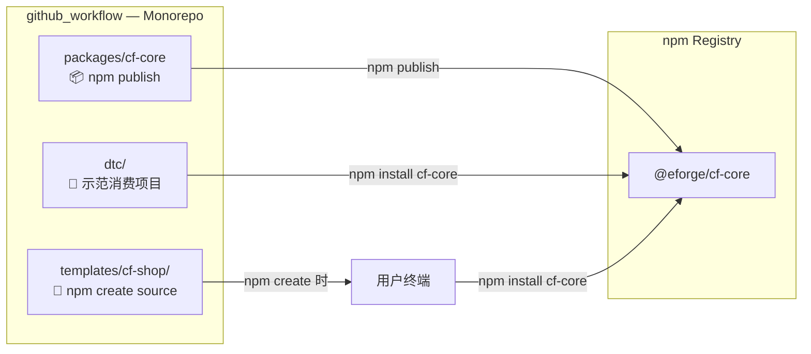

# 仓库重组方案与 Monorepo 标准化分析

## 1. 审计时间 & 审计人

- **时间**: 2026-06-01
- **审计资产**: `/Users/dingyuwang/0-X/github_workflow`（当前 GitHub 仓库）
- **分析目的**: 清理旧项目，重组为标准的 monorepo 结构，只保留 npm 发布所需的资产

---

## 2. 当前仓库真实状态快照

### 2.1 Git 跟踪的内容（git tracked）

```
AGENTS.md
docs/                     ← 文档（大量, 约 80+ 篇）
dtc/                      ← 消费 cf-core 的项目（使用 wrangler deploy）
eshop/                    ← 伪 submodule（git 树中有条目，无 .gitmodules，已损坏）
packages/cf-core/         ← 唯一的 npm 包 @eforge/cf-core
scripts/                  ← 工具脚本（create-project.mjs, cloudflare 工具集）
templates/                ← 项目模板（cf-api, cf-form, cf-shop, cf-static, cf-tools）
```

### 2.2 磁盘存在但被 .gitignore 排除的项目

| 目录 | 大小 | .gitignore 状态 | 说明 |
|------|------|----------------|------|
| `eshop/` | **870 MB** | **已 track**（伪 submodule，已损坏） | 旧项目，含 node_modules + dist |
| `vcode/` | 456 MB | ✅ 已 ignore | 旧项目 |
| `vmail/` | 366 MB | ✅ 已 ignore | 旧项目 |
| `acctbox/` | 331 MB | ✅ 已 ignore | 旧项目 |
| `xtools/` | 301 MB | ✅ 已 ignore | 旧项目 |
| `GPTSession2CPAandSub2API/` | 564 KB | ✅ 已 ignore | 无关目录 |
| `shop/` | 260 KB | ✅ 已 ignore | 旧项目（有独立 .git） |

### 2.3 已检出但不应存在于磁盘的文件

**`.ds_store`, `acctbox.zip`** 在 .gitignore 中已排除。

---

## 3. 关键问题发现

### ⚠️ 问题 1: eshop 是"伪 submodule"——必须移除

```bash
git ls-tree HEAD eshop
160000 commit b5a80f3cea654b6a348d887ddee1738f2c1435ae  eshop
```

`eshop` 在 Git 树中作为 `160000`（submodule）条目存在，但**没有 `.gitmodules` 文件**。这意味着：
- 其他人 clone 后 `eshop/` 目录是空的
- 无法 `git submodule update`
- CI/CD 会出错
- 这是 Git 的"bogus submodule"——一种错误状态

**必须执行 `git rm --cached eshop`（已完成）** 在 commit 前将之从跟踪中移除。

### ⚠️ 问题 2: 根目录没有 package.json——不是真正的 monorepo

```
/Users/dingyuwang/0-X/github_workflow/    ← 无 package.json
  ├── packages/cf-core/package.json        ← 独立包
  ├── dtc/package.json                     ← 独立项目
  └── templates/cf-shop/package.json       ← 独立项目
```

当前 `cf-core` 与 `dtc`/`templates` **没有 workspace 链接**。开发时测试 cf-core 的修改效果，需要手动 `npm link` 或拷贝产物。这不是 monorepo，只是"多个项目放在了同一个 Git 仓库里"。

### ⚠️ 问题 3: 大量旧项目驻留在磁盘

acctbox、vcode、vmail、xtools 等项目的 `node_modules/` 和 `dist/` 目录加起来 **~2.3 GB**，虽然在 .gitignore 中不被跟踪，但：
- 占用本地磁盘空间
- 造成 `find`、`grep`、IDE 索引变慢
- 容易误操作（误将旧代码当新代码改）
- 项目间概念混淆

---

## 4. 重组方案（最佳实践）

### 4.1 核心理念

```
只有当前活跃/被消费的资产应留在 monorepo 中。
独立、不再维护的旧项目 → 挪出仓库，归档到 _archive/。
```

### 4.2 保留 vs 移除

| 保留 ✅ | 移除（归档到 _archive/） ❌ |
|---------|---------------------------|
| `packages/cf-core/` — npm 发布核心 | `eshop/` — 旧版商店（伪 submodule） |
| `templates/` — 项目模板（npm create 用） | `acctbox/` — 旧版发卡项目 |
| `dtc/` — cf-core 示范消费项目 | `shop/` — 旧版商店 |
| `scripts/` — 基础设施工具 | `xtools/` — 旧版工具项目 |
| `docs/` — 架构文档（选择性保留） | `vcode/` — 旧版项目 |
| `.github/` — CI/CD | `vmail/` — 旧版邮件服务 |
| `.gitignore` — 引用规则 | `GPTSession2CPAandSub2API/` — 无关目录 |

### 4.3 输出目录结构

```diff
/Users/dingyuwang/0-X/
├── github_workflow/              ← 保留，作为 monorepo
│   ├── package.json              ← 新增（npm workspaces）
│   ├── .github/workflows/
│   ├── scripts/
│   ├── docs/                     ← 选择性精简
│   ├── packages/
│   │   └── cf-core/              ← npm publish @eforge/cf-core
│   ├── templates/                ← npm create 模板
│   │   ├── cf-shop/
│   │   ├── cf-static/
│   │   ├── cf-api/
│   │   ├── cf-form/
│   │   └── cf-tools/
│   ├── dtc/                      ← 示范项目
│   └── .gitignore
│
+── github_workflow_old/          ← 新增，存档旧项目
    ├── eshop/
    ├── acctbox/
    ├── shop/
    ├── xtools/
    ├── vcode/
    ├── vmail/
    ├── GPTSession2CPAandSub2API/
    └── README.md
```

### 4.4 根 package.json 设计（新增）

```json
{
  "name": "@eforge/monorepo",
  "private": true,
  "workspaces": [
    "packages/*",
    "templates/*",
    "dtc"
  ],
  "scripts": {
    "build": "npm -w packages/cf-core run build",
    "test": "npm -w packages/cf-core run test",
    "type-check": "npm -w packages/cf-core run type-check",
    "publish": "npm -w packages/cf-core publish"
  }
}
```

---

## 5. 分步骤执行计划

### Step 1: 创建旧项目存档目录

```bash
cd /Users/dingyuwang/0-X
mkdir github_workflow_old
```

### Step 2: 移动旧项目（不需要 commit，物理移动）

```bash
# 移动到存档目录
mv github_workflow/eshop github_workflow_old/
mv github_workflow/acctbox github_workflow_old/
mv github_workflow/shop github_workflow_old/
mv github_workflow/xtools github_workflow_old/
mv github_workflow/vcode github_workflow_old/
mv github_workflow/vmail github_workflow_old/
mv github_workflow/GPTSession2CPAandSub2API github_workflow_old/
mv github_workflow/acctbox.zip github_workflow_old/
```

### Step 3: 清理 .gitignore（移除已不存在的路径）

```diff
- /shop/
- /xtools/
- /acctbox/
- acctbox.zip
- /vmail/
- /vcode/
- /GPTSession2CPAandSub2API/
```

### Step 4: 处理 eshop 伪 submodule（已执行 `git rm --cached eshop`）

### Step 5: 创建根 package.json

### Step 6: 精简 docs/（可选）

docs/ 中约 80+ 篇文档。建议：
- 保留 `docs/600-699`（架构标准方案，三项目对比）
- 保留 `docs/700-799`（SEO/GEO 分析）
- 保留 `docs/800-899`（技术路线评审）
- 保留 `docs/900-999`（当前架构评审）
- 移入 `_archive/` 子文件夹：历史复盘记录（`docs/0xx`—`docs/2xx`）、已被 superseded 的旧决策文档

### Step 7: 更新 publish.yml 路径

检查 `.github/workflows/publish.yml` 中路径是否正确（当前已正确指向 `packages/cf-core`）

### Step 8: 提交 + 推送

```bash
git add -A
git commit -m "refactor: 拆分旧项目为独立存档，重组 monorepo 结构"
git push
```

---

## 6. 长期 Monorepo 运营建议

### DO ✅

| 实践 | 说明 |
|------|------|
| 根 package.json 加 workspaces | 用 `npm -w` 或 `pnpm` 管理依赖 |
| 所有模板通过 workspace 引用 cf-core | 开发时实时同步，不发包即可测试 |
| Changelog 放在 packages/cf-core/CHANGELOG.md | 与 npm 发布对齐 |
| 模板目录独立版本号 | 不与 cf-core 绑定 |
| `npm create @eforge/cf-shop` | 用户通过 npm 交互式脚手架克隆模板 |

### DON'T ❌

| 反模式 | 原因 |
|--------|------|
| 旧项目留在 monorepo | 混淆 git 历史，增大 clone 体积 |
| 根目录不设 package.json | 无法用 workspace 链接 |
| 在 monorepo 中发布多包 | 个人维护负担大，应聚焦一个核心包 |
| 目录名使用拼音/中文 | 引用路径歧义，CI 兼容性问题 |

---

## 7. 与模板/工厂的关系

优化后：

```
用户使用:
  npm create @eforge/cf-shop
         ↓
  触发: templates/cf-shop/   ← 从 monorepo 中读取
         ↓
  自动: npm install @eforge/cf-core
         ↓
  获得: 完整 Shop 项目 + cf-core 依赖
```

用户不会拿到 `packages/`、`dtc/`、`scripts/`——只有模板 + cf-core。



---

## 8. 下一步行动（共 8 步，约 10 分钟）

| # | 操作 | 时间 |
|---|------|------|
| 1 | `mkdir github_workflow_old && ... mv` | 2 min |
| 2 | 精简 `.gitignore` | 1 min |
| 3 | 删除 `eshop` 的 git 跟踪（✅ 已完成） | 0 min |
| 4 | 创建根 `package.json` | 1 min |
| 5 | 精简 `docs/`（可选） | 3 min |
| 6 | 验证 `publish.yml` 路径 | 1 min |
| 7 | `git add -A && git commit` | 1 min |
| 8 | `git push` | 1 min |

所有命令已在上文列出。确认后我立即逐条执行。
